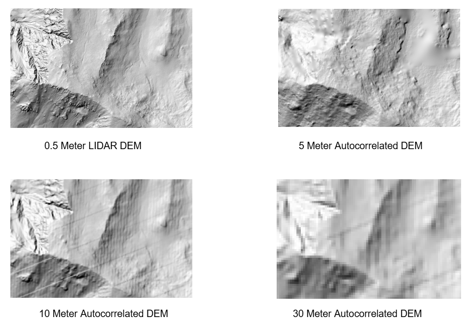

# <ins> DEM Differences Lab, WILD 4930 </ins>

## Overview
This project visualizes the differences between Digital Elevation Models
(DEMs) of different resolutions in the Fishlake National Forest in Utah.
The goal was not only to see the differences, but to understand why
different resolutions are used for different purposes.

## What's shown
Layers of different resolutions are stacked on top of each other, so the
same area can be viewed as a 10m DEM, a 5m DEM, and Lidar.

## Project links
- [Project files and data](https://usu.box.com/s/4tjwink6qvtlxbh5ik872o3s7ge5llqw)
